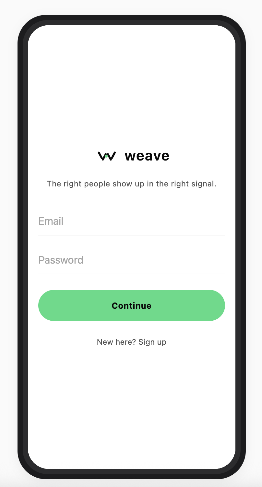
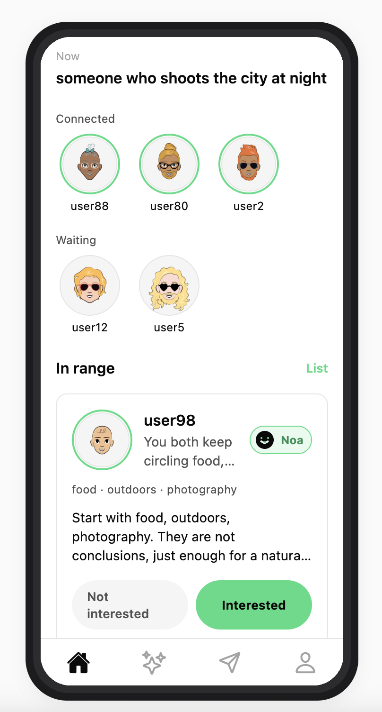
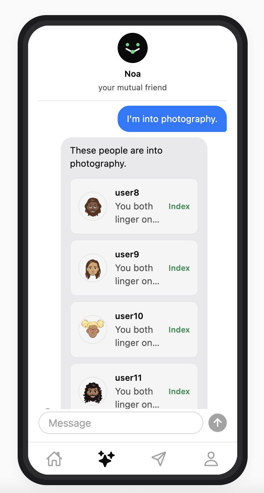
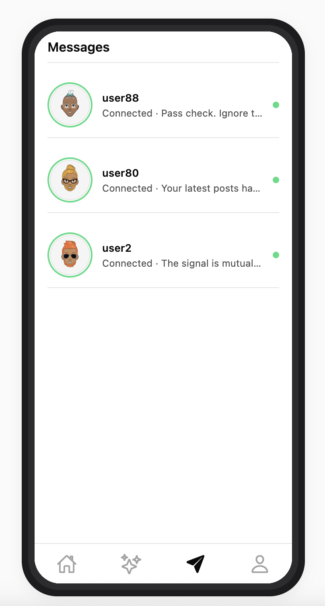
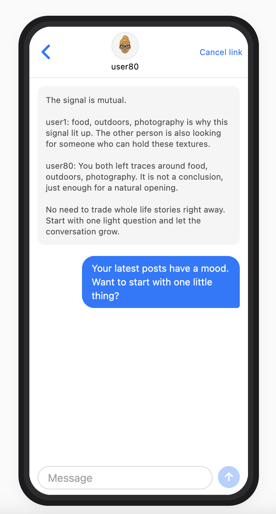
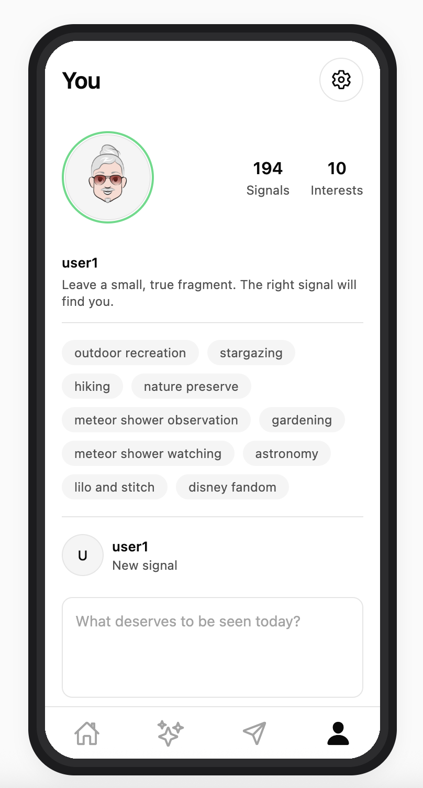
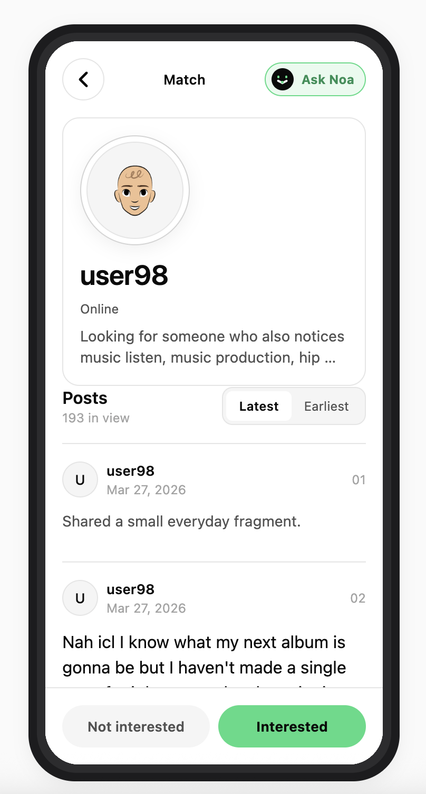
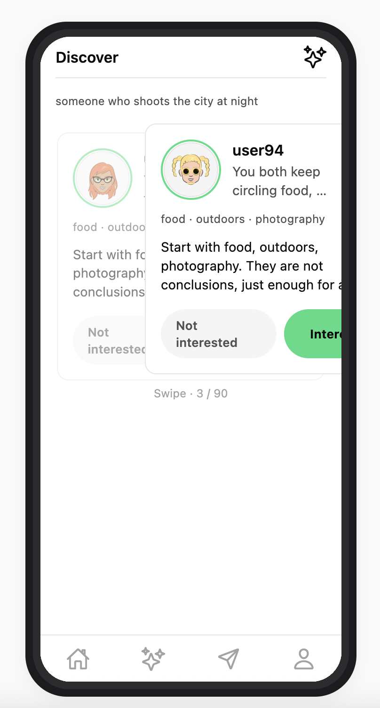
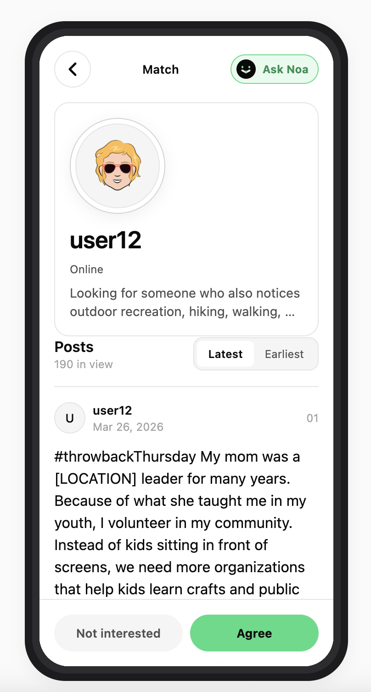

# Weave

## 界面预览

<p>
  
  
  
  
</p>
<p>
  
  
  
  
</p>
<p>
  
  
</p>

## 数据集

本地开发会用到两套数据：

- `socialpersona-6E9B`：约 100 个匿名用户的画像与帖子，启动时导入成演示账号池。
- `CartoonSet-100`：对应头像图（`001.png`–`100.png`）。

## 启动

```bash
python3 -m venv .venv
source .venv/bin/activate
pip install -r apps/api/requirements.txt
cp .env.example .env
npm install
```

API：

```bash
source .venv/bin/activate
npm run dev:api
```

前端（Web）：

```bash
npm run dev:expo:web
```

前端（手机 / 模拟器）：

```bash
npm run dev:expo
npm run dev:expo -- ios
npm run dev:expo -- android
```

Docker 只起 API：

```bash
docker compose up --build api
```
